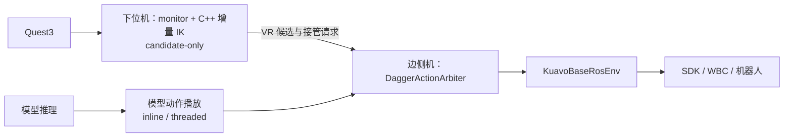

# LeTools Quest3 DAgger

在模型推理期间使用 Quest3 接管手臂、末端和可选的 5W 下半身，录制带介入标记的 rosbag，再转换为 LeRobot 数据集。本文统一说明安装、启动、操作和数转；命令均在相应仓库根目录执行，主机地址、模型和路径按现场修改。

## 控制架构



模型与 VR 持续生成候选，最终命令由 LeTools 环境统一下发。下位机必须运行 `dagger_candidate_only:=true`，避免普通 VR 同时通过 ROS、SHM 或控制服务驱动机器人；独立的 `/stop_robot` 急停链路继续有效。

接管时等待握把按下之后的新 arm/eef 候选，确认下位机已为本轮介入准备好手臂动作，再平滑进入 VR；释放或输入过期后保持最后选中的动作、丢弃旧模型队列，等待新模型输出后平滑交回。手臂回切插值以实际下发的命令为起点。`run` 与 `dagger` 使用本分支的同一推理入口、动作缓存和播放实现；`dagger` 在模型播放之后增加介入仲裁。仲裁目标频率直接使用 `env.control_rate`，模型补算期间仍持续处理 VR。

## 边侧与 KRC 配套要求

本文的配套模式使用带就绪状态的手臂候选协议 `schema_version=1`。下位机在同一条消息中发送位置、速度及本轮接管状态，边侧确认这些信息有效后接管。需要同时满足：

| 位置 | 配套要求 |
| --- | --- |
| 下位机 KRC | 包含新候选发布逻辑，编译并运行 `wheel_ik_ros_uni_cpp_node`；candidate-only 模式持续发布 `/dagger/vr/arm_candidate`，类型为 `std_msgs/String`，`data` 是 JSON |
| 边侧 LeTools | 固定使用 `kuavo_deploy/utils/dagger_action_arbiter.py` 中的新协议接收逻辑；`inference.dagger_vr_candidate_topic` 默认 `/dagger/vr/arm_candidate`，仅在下位机使用其他话题名时覆盖 |
| 5W 执行服务 | 提供 `/enable_arm_traj_interpolator`（`std_srvs/SetBool`）、`/humanoid_wheel/set_incremental_arm_traj_link`（`kuavo_msgs/SetIncrementalArmTrajLink`）及 `/enable_lb_arm_quick_mode`（`kuavo_msgs/changeLbQuickModeSrv`）；边侧初始化会启用插补、绑定 `/kuavo_arm_traj` 并设置 `quickMode=2` |
| 躯干跟随 | 开启 `dagger_waist_on: true` 时，KRC 必须包含下文的 `waist` 候选扩展与配置确认逻辑；KRC 本地订阅适配器的 `/dagger/vr/body_pose` 并求解四关节候选 |

配套版本按上述协议和服务判定。下文启动命令以四维下半身、十四维手臂的 5W 轮臂为例。部署记录应保存两边仓库的 `git rev-parse HEAD` 和 `git status --short`，便于还原现场版本。

下位机 launch 使用 `dagger_candidate_only:=true`，让 VR 仅生成候选。边侧从 `inference.dagger_vr_candidate_topic` 读取手臂候选，默认话题为 `/dagger/vr/arm_candidate`，检查位置、速度、请求、就绪状态和介入代次。启动时等待首条候选消息的上限为 3 秒；消息超时或未得到合法候选时初始化失败。以下话题检查命令使用默认名称，自定义后须相应替换。

## 安装与 ROS 网络

机器人下位机使用 `kuavo-ros-control` 的 `yichao/dagger` 分支；先按该仓库的 `README_DAGGER_5W_DEPLOY.md` 完成 catkin 编译和 wheel 部署。编译结束后再复制 SDK 和生成的消息包。

边侧机获取代码并创建 eval 环境，先完成通用安装：

```bash
# 使用已经发布且包含本次 DAgger 移植的分支；本地移植分支尚未推送时直接使用本地工作树。
git clone -b "<DAGGER_RELEASE_BRANCH>" https://www.lejuhub.com/highlydynamic/LeTools-Learning.git
cd LeTools-Learning
git submodule update --init --recursive
conda create -n letools python=3.12 -y
conda activate letools
source /opt/ros/noetic/setup.bash
bash setup_env.sh
```

SDK 安装请参考 [LeTools 官方教程](https://www.letools.lejurobot.com/docs.html?type=learning#heading-12) 中的 **（b）可以拷贝机器人下位机的 `kuavo-ros-opensource` 的内容安装**，按该方式在边侧 `letools` 环境中完成安装。

外置模型使用各自的环境。

下位机和边侧机的 ROS 终端使用同一个 master，各自填写可被对端访问的本机 IP，并同步两机时钟：

```bash
source /opt/ros/noetic/setup.bash
export ROS_MASTER_URI="http://<ROS_MASTER_IP>:11311"
export ROS_IP="<本机可被对端访问的IP>"
rostopic list
```

## 下位机启动

终端 1 启动运控，沿用设备所需的用户权限与 `ROBOT_VERSION` 设置：

```bash
cd /path/to/kuavo-ros-control-dagger
source devel/setup.bash
roslaunch humanoid_controllers load_kuavo_real_wheel.launch
```

机器人准备好后，终端 2 按现场流程完成位姿标定，启动 VR 候选链路：

```bash
cd /path/to/kuavo-ros-control-dagger
source devel/setup.bash
python3 src/demo/test_kuavo_wheel_real/timedCmd_example/pyset_robot.py
roslaunch noitom_hi5_hand_udp_python launch_quest3_ik.launch \
  dagger_candidate_only:=true use_cpp_monitor:=true \
  use_cpp_incremental_ik:=true use_incremental_hand_orientation:=true \
  wheel_ik:=true use_arm_only_ik:=false reset_joint_to_default:=false
```

默认自动发现同一局域网的 Quest3；失败时在 launch 命令后追加 `ip_address:=<QUEST3_IP>`。可用 `rosparam get /quest3/connected` 检查连接。

先停止旧的普通 VR launch，再启动候选模式；只修改 `/quest3/dagger_candidate_only` 参数不会更新已运行 IK 节点缓存的模式。上述命令显式选择 wheel C++ IK 入口，不依赖 launch 文件的默认值。四关节躯干跟随要求候选适配器发布 Chest（23）的 `/dagger/vr/body_pose`，由 KRC 本地接收；适配器同时发布 Head（25）的 `/dagger/vr/head_pose`，头部位姿不参与躯干控制。

更新 KRC 的 C++ 候选逻辑后，在 KRC 根目录执行 `catkin build motion_capture_ik`，再 `source devel/setup.bash` 并重新启动上述 VR launch；已运行进程不会自动加载新二进制。更新 Python 适配器后也需重启 launch。边侧修改部署 YAML 后，退出旧 eval 菜单，按实际配置路径重新启动；仅修改候选协议或渐变配置时，模型服务无需重启。

在边侧机先确认候选和请求能持续到达：

下面的命令逐条执行；`rostopic hz` 会持续运行，查看频率后用 `Ctrl+C` 结束，再执行下一条。`echo -n 1` 只查看一帧，按住、释放握把时可重复检查对应请求。

```bash
rosparam get /quest3/dagger_candidate_only
rostopic type /dagger/vr/arm_candidate
rostopic hz /dagger/vr/arm_candidate
rostopic echo -n 1 /dagger/vr/arm_candidate
rostopic hz /dagger/vr/eef_action
rostopic echo -n 1 /dagger/vr/left_intervention
rostopic echo -n 1 /dagger/vr/right_intervention
```

| 话题 | 类型与内容 |
| --- | --- |
| `/dagger/vr/arm_candidate` | `std_msgs/String`，JSON 包含手臂位置、速度、请求及就绪状态；扩展的 `waist` 对象携带腰部关节候选及其独立源时间戳 |
| `/dagger/vr/eef_action` | `sensor_msgs/JointState`，左右 trigger 对应两个 `[0,1]` 末端候选 |
| `/dagger/vr/{left,right}_intervention` | `std_msgs/Bool`，对应握把接管请求及心跳 |
| `/dagger/vr/body_pose` | `geometry_msgs/PoseStamped`，KRC 本地的胸部输入，边侧不订阅、不求解 |
| `/dagger/vr/waist_config` | `std_msgs/String`，边侧自动发布的 latched 配置，KRC 接收并在候选中确认 |

### 新手臂候选协议

`/dagger/vr/arm_candidate` 的 `data` 是 JSON 字符串，字段如下。手臂数组始终为左臂 7 维、右臂 7 维，即使边侧只控制一侧也保留 14 维；数组不包含夹爪或下半身。

| 字段 | 类型与含义 |
| --- | --- |
| `schema_version` | 整数，当前为 `1` |
| `session` | 非空字符串，标识下位机 IK 节点本次启动；节点重启后变化 |
| `sequence` | 非负整数，同一 session 内逐帧递增；边侧忽略重复或倒序消息 |
| `stamp_ns` | 正整数，下位机发布候选时的 ROS 时间，单位纳秒；不代表硬件执行时刻 |
| `position` | 14 个有限数值，单位 rad |
| `velocity` | 14 个有限数值，单位 rad/s，与 position 属于同一候选帧 |
| `left_requested` / `right_requested` | 布尔值，下位机收到的对应侧介入请求 |
| `left_ready` / `right_ready` | 布尔值，对应侧已完成本轮锚点和 IK 准备，可开始接管 |
| `left_generation` / `right_generation` | 非负整数，对应侧请求状态在按下或释放时变化就递增；与 session 一起区分不同轮次，不能当作按下次数 |
| `waist` | 腰部扩展对象，字段见下表；只在开启腰部介入时要求存在 |

未按 grip 时，候选应持续发布，对应侧 `requested=false`、`ready=false` 属于正常状态。按下 grip 后，下位机先根据实测姿态重建锚点，完成本轮有效 IK 求解及发布状态同步后才置为 `ready=true`；期间未就绪侧使用实测位置和零速度。松开后对应侧重新变为未请求、未就绪。

边侧初始化只要求收到字段合法、时间新鲜的候选包，不要求此时按住 grip 或 `ready=true`。实际手臂接管还要求对应 intervention 请求有效，arm/eef 候选在按下后更新，并且包内对应侧 `requested=true`、`ready=true` 且代次有效。`ready` 表示候选准备完成；实际选用的来源可查看运行日志中的 `DAgger arbitration ... source=...`，启用录制时还会写入 `/dagger/decision`。

边侧按 `stamp_ns` 检查消息年龄：不能早于当前 ROS 时间超过 `dagger_vr_action_timeout`（默认 0.2 秒），也不能超前超过 0.05 秒。因此两机必须使用一致的 ROS 时间并同步时钟。持续收到消息但报 `Stale candidate packet` 时，需同时检查时间偏差和传输延迟。

腰部候选扩展保持 `schema_version=1`，不改变原有手臂字段。`waist` 包含：

| 字段 | 类型与含义 |
| --- | --- |
| `config_session` | 当前边侧配置会话；必须与边侧本轮发送的值匹配 |
| `requested` / `ready` | 有效控制侧 grip 请求；本轮腰部锚点、反馈和 IK 是否有效 |
| `generation` | 每次重新建立腰部锚点递增；与节点 session、配置会话一起区分介入轮次 |
| `stamp_ns` | 本次候选依赖的胸部位姿和反馈中较早的源时间，单位 ns；重复发布不会刷新旧输入的年龄，未就绪时为 0 |
| `position` | 四个有限弧度值，顺序 `[knee, leg, waist_pitch, waist_yaw]` |

腰部开启时，边侧自动通过 `/dagger/vr/waist_config` 发送 `schema_version=1`、随机 `session`、`which_arm`、四维 `lower`/`upper`、`lock_mask`/`lock_position`、`max_speed`、`action_timeout` 和 `signal_timeout`。关节限位和锁定位置单位 rad，速度 rad/s，超时 s；KRC 还会施加自身 URDF 限位。每个 episode 重新生成配置会话，避免沿用上一条数据的腰部锚点。

初始化最多等待 3 秒确认配置会话，不要求按住 grip。仅支持旧手臂候选的 KRC 仍可用于未开启腰部的任务；开启腰部时必须重新编译并重启配套 KRC，否则初始化报错。边侧没有腰部 IK 回退。内部配置话题及 KRC 的身体输入话题不增加 YAML 开关；需要更改名称时应统一 ROS remap。


轮式 IK 在候选模式下可能仍注册硬件话题的 publisher，但不会发送硬件命令；部署预检查同时核对候选订阅和普通 VR 控制节点。不能仅凭 publisher 名单判定冲突。

## 选择模型与部署配置

使用通用部署配置 [deploy.yaml](configs/deploy/deploy.yaml)，按实际任务设置控制侧、末端类型、全身开关和模型参数。

服务端、部署和数转的 `which_arm`、末端类型及物理 state/action 布局必须一致。当前 DAgger 要求每侧手臂为 7 维、末端为 1 维；双臂顺序为 `[左臂7, 左末端1, 右臂7, 右末端1]`。下表按每侧一个末端开合标量计算，多自由度手部模型需先确认是否符合此要求。

| 控制侧 | 手臂 state/action | 加四维下半身后的 state/action |
| --- | ---: | ---: |
| `left` 或 `right` | 8 | 12 |
| `both` | 16 | 20 |

全身模式的末尾四维为 `[knee, leg, waist_pitch, waist_yaw]`；state 和数据集 action 使用弧度。状态来自 `/sensors_data_raw` 的 `joint_q[0:4]`，实际命令来自 `/lb_leg_traj`，该命令及 SDK 使用角度，数转时转回弧度。开启 `5w_base_move` 时再在 action 末尾追加 `[vx, vy, vyaw]` 三维，state 维数不变。

下面以双臂强脑手、仅接管手臂和末端为例。将这些字段合并到现有通用部署配置的对应段中，相机、模型和关节限位按设备填写；使用乐聚夹爪时将 `eef_type` 改为 `leju_claw`。

```yaml
env:
  inference_env: real
  platform_type: "5w"
  which_arm: both
  eef_type: qiangnao
  control_mode: joint
  5w_wholebody: false
  5w_base_move: false
  5w_lowerlock: [0, 0, 0, 0]
  direct_to_wbc: true
  enable_action_interpolation: true
  execution_mode: inline  # 可选 inline/threaded，模型播放方式见下文
  ros_rate: 10
  control_rate: 100
  camera_encoding: h265  # 对应下位机发布 /cam_{h,l,r}/color/h265_stream；JPEG 时改为 jpeg
inference:
  policy_type: client
  task_prompt: "Pick and Place"
  eval_episodes: 1  # 一次采集运行一轮模型；多轮的录包规则见下文
  max_episode_steps: 200  # 每轮模型步数上限，按采集长度调整
  async_inference: false
  rtc_enabled: false
  dagger_handover_duration: 0.3
  dagger_policy_handover_duration: 0.5
  dagger_waist_on: false
  dagger_waist_pose_max_speed: 1.0
  rosbag_output_dir: outputs/dagger
```

主部署 YAML 只列出五个常用的 DAgger/录制参数：接管时间、回切时间、腰部介入开关、
腰部跟随速度和录制目录。其余参数可省略；未在任务 YAML 或总配置中指定时，使用
`kuavo_deploy/config.py` 的默认值。需要自定义话题、超时或录制设置时，按下方
“高级参数覆盖”在任务 YAML 的对应段添加字段即可。

公共 `configs/deploy/deploy.yaml` 保留 beta 的通用设备配置和模型路径占位符，
默认使用可加载的 `execution_mode: inline`。实际运行前需按机器人、模型和任务修改。
DAgger 必须将 `env.direct_to_wbc` 设为 `true`；若选择 `threaded`，还需启用动作插值。
普通 `run` 可以保留 `direct_to_wbc: false` 和 `execution_mode: inline`。

DAgger 由菜单或 `--task dagger` 启用，要求实机、joint 控制和 `direct_to_wbc: true`。可以同时启用 RTC；这时还要求 `policy_type: client`、`async_inference: true` 和支持对应 RTC 模式的模型服务。普通 `run` 保留 dev 的同步/异步推理、RTC 及原有播放方式。

总配置 `configs/deploy/total/deploy_total.yaml` 的 `execution_mode` 默认值与本分支默认配置一致，
为 `inline`；任务 YAML 可以显式覆盖为 `threaded`。模型观测对所有任务都按
`env.which_arm` 选择相机：`left` 保留头部和左腕，`right` 保留头部和右腕，
`both` 保留两侧；对侧深度相机同样过滤。录包独立使用配置中的完整相机话题列表。

### 推理与动作播放

`run` 与 `dagger` 使用 `real_single_test.py` 的推理循环。推理方式和播放方式是两组独立设置：

| 设置 | 行为 |
| --- | --- |
| `inference.async_inference: false` | 使用 `policy.select_action()` 和模型内部缓存，缓存耗尽时按需补算 |
| `inference.async_inference: true` | 使用 dev 的 `AsyncInference` 预取下一动作段；普通异步按配置对齐和融合，启用 RTC 时使用其前缀及分块衔接逻辑 |
| `env.execution_mode: inline` | 由 `env.step()` 生成线性插值点，末端目标不做位置插值；DAgger 增加独立发送线程，逐点接收并仲裁，模型补算期间继续处理 VR |
| `env.execution_mode: threaded` | 使用本分支的 `ControlLoop` 对模型目标做分段线性插值，保留限速和接近目标时的吸附；DAgger 在实际下发前仲裁，末端对最终选中的目标去重 |

`threaded` 播放需要 `direct_to_wbc: true` 和 `enable_action_interpolation: true`。关闭插值时实际走 inline 路径，模型每步只生成一个目标点。DAgger 的两种播放方式都只保留一个发送者，模型计算与通信不占用仲裁线程。

`threaded` 可以与同步或异步推理组合使用。每个新模型目标从上一条播放指令开始，
按 `1 / env.ros_rate` 秒生成一段线性插值；例如 `ros_rate: 10`、`control_rate: 100` 时，
一段为 100 ms，分为 10 个控制周期。中途收到更新目标时，从当前播放值重新起段；
限速或接近目标时的吸附可能改变理想直线，分段之间也不保证速度连续。

DAgger 的 VR 候选在上述模型插值之后参与仲裁，不经过模型的线性插值段，
继续使用接管渐变和下位机原有的执行通路。释放介入后，旧动作和在途推理结果失效；
新模型动作的插值起点使用最后实际下发的指令，避免从介入前的旧位置回跳。
两种播放方式都支持下述 DAgger 与 RTC 的组合。

`env.ros_rate` 是模型动作推进的目标节拍，整段动作的补算频率还取决于缓存长度和推理耗时。DAgger 仲裁的目标节拍为 `env.control_rate`，且不能低于 `ros_rate`；例如模型目标 10 Hz、仲裁目标 100 Hz。实际频率和最大周期间隔可查看每秒输出的 `DAgger arbitration: ...Hz, max_interval=...ms, source=...`。

`inference.async_timeout_s` 默认 30 秒，用于 DAgger 的远程模型通信、异步动作等待和 inline 指令确认。超时或下发失败会中止本次任务。`max_episode_steps` 统计完成的模型循环步数，持续人工介入时仍会推进；被回切刷新打断的步骤不计数。达到上限后结束当前模型轮次，`eval_episodes` 决定是否开始下一轮。一次菜单录制任务始终只生成一条 bag，按一轮采集时设 `eval_episodes: 1`。

### DAgger 与 RTC

在任务配置中合并以下字段，再选择菜单 `3 dagger`。`execution_mode` 仍可使用 `inline` 或 `threaded`，模型动作频率和控制频率沿用任务配置：

```yaml
env:
  direct_to_wbc: true
inference:
  policy_type: client
  async_inference: true
  rtc_enabled: true
  rtc_mode: guided  # trained 需要经过 RTC 训练、且服务端支持相应延迟范围的 checkpoint
```

| 阶段 | RTC 请求及动作处理 |
| --- | --- |
| 纯模型执行 | 正常使用剩余模型动作作为前缀；首次没有动作缓存时以前缀为空、`inference_delay=0` 开始 |
| 手臂或腰部开始介入、持续遥操 | 模型照常推理，保留其动作队列、RTC 前缀和在途请求；机器人通过 DAgger 仲裁执行 VR 或模型动作 |
| 任一已介入部位松手、候选失效或暂停 | 沿用 DAgger 的模型刷新：旧队列、前缀及在途结果失效，保持最后实际下发的指令，重新读取观测 |
| 刷新后的第一批模型动作 | 使用空前缀、`inference_delay=0`，建立新的模型原始动作、处理后动作及观测上下文 |
| 新模型动作建立后 | 按普通 RTC 预取规则恢复前缀；回切渐变结束时不再清队列，其他部位仍介入也不阻止模型维护前缀 |

介入期间的前缀描述模型自己的连续计划，接管部位实际执行 VR 动作。前缀始终来自模型输出，不把 VR 或回切混合动作编码进去。RTC 接口及 `guided/trained` 模式不变，运行中无需切换 YAML。

刷新由原有 DAgger 和异步推理代次处理：松手前的模型动作不能越过回切边界，旧在途结果晚到也不会合入刷新后的队列。部分释放同样刷新整条模型队列，仍在介入的其他部位继续遥操。新观测由 rollout 线程读取，模型线程不访问机器人环境。

高频仲裁和下发继续由原发送线程负责，不等待模型 RPC。松手后等待新模型动作的时间仍存在；如果未介入侧的已接收队列也耗尽，它会保持当前指令等待新动作。恢复 RTC 时不额外清空一次播放队列。

暂停会刷新模型；新 episode 重新建立动作队列和前缀。`trained` 仍校验 checkpoint 支持的延迟范围，介入期间保留前缀不会放宽该限制。下位机继续使用现有候选协议。

### 模型预检与控制侧

DAgger 使用正式观测和第一条模型动作校验维度与有限值，通过后才下发该模型动作，不额外试推理。单臂或 5W 全身远程模型的 metadata 必须返回匹配的 `which_arm`；若提供 `state_dim`、`action_dim`，也必须与部署一致。普通 `run` 沿用本分支的检查流程。

DAgger 客户端会将服务端错误响应和模型重置失败作为异常退出。夹爪观测 `env.is_binary` 应与训练数据一致；连续 Leju 夹爪观测的任务设为 `false`。

`env.5w_wholebody: true` 会把四维下半身加入模型观测和动作，并执行模型给出的下半身目标；`inference.dagger_waist_on: true` 则允许人工候选覆盖其中未锁定的关节。全身采集需在部署与数转两端开启 `5w_wholebody`，模型也须支持对应维度。即使计划一直用 VR 接管四关节，启动前、释放后仍会使用模型动作。

`5w_lowerlock` 按四维顺序设置，`1` 表示锁定为 `inference.go_bag_path` 中 `/lb_leg_traj` 的首帧值，因此必须提供包含四维角度命令的 bag。锁定关节的反馈和命令仍会录制，全身 state/action 仍保留四维。

单臂 DAgger 仅支持实机 joint 控制及 qiangnao / Leju claw。每次启动读取一次另一侧手臂和完整手部的真实状态（反馈年龄不超过 0.5 s），后续持续下发该姿态；不保存跨任务状态，也不持续检查另一侧的反馈偏差。`both` 不启用这项保持。policy 使用头部及控制侧腕相机，录包保留配置中的完整相机列表。

### 高级参数覆盖

以下参数保留配置能力，主部署 YAML 省略它们时仍执行对应的新鲜度和录制检查。
表中的默认值来自 `kuavo_deploy/config.py`；任务 YAML 优先于总配置，总配置优先于代码默认值。
超时值表示允许的数据年龄，不表示每次接管要额外等待这么久。

| 参数（包含所属段） | 默认值 | 含义及生效条件 |
| --- | --- | --- |
| `inference.dagger_vr_action_timeout` | `0.2` s | 正数；手臂、末端和腰部候选的新鲜度上限，也用于腰部反馈及身体位姿时间戳检查 |
| `inference.dagger_signal_timeout` | `0.2` s | 正数；请求接收超时后释放接管并等待新模型动作。边侧使用控制侧 grip 心跳，KRC 求解腰部时另行检查每侧请求是否新鲜 |
| `inference.rosbag_min_free_gb` | `10.0` GiB | 有限正数；启动前及录制中检查空间，低于阈值拒绝开始或停止本条采集 |
| `inference.rosbag_buffer_mb` | `256` MB | 正整数；传给 `rosbag record --buffsize` 的内存缓冲大小 |
| `inference.rosbag_extra_topics` | `[]` | 额外录制话题列表；每项以 `/` 开头且不含空白，单臂和双臂使用相同规则 |

话题名默认与配套 KRC 一致，均为绝对 ROS 话题名；只有实际部署改名时才需覆盖。

| `inference` 下的参数 | 默认话题 | 消息及用途 |
| --- | --- | --- |
| `dagger_vr_candidate_topic` | `/dagger/vr/arm_candidate` | `std_msgs/String`，JSON `schema_version=1`；14 维位置 rad、速度 rad/s 及请求、ready、介入代次，用于手臂控制、启动路由检查和录包 |
| `dagger_vr_eef_topic` | `/dagger/vr/eef_action` | `JointState.position=[左末端,右末端]`，归一化到 `[0,1]` |
| `dagger_left_intervention_topic` | `/dagger/vr/left_intervention` | `std_msgs/Bool`；`true` 请求左侧接管，`false` 释放；单臂任务只订阅控制侧 |
| `dagger_right_intervention_topic` | `/dagger/vr/right_intervention` | `std_msgs/Bool`；`true` 请求右侧接管，`false` 释放；单臂任务只订阅控制侧 |

`env.recording_obs_key_map` 由加载器自动派生，用于保留完整录包视角，无需手动填写。录制由菜单控制，不使用 `record_rosbag` 配置开关。

### 启动模型服务

边侧机终端 1 启动与任务匹配的外置模型，等待 `Server is ready and listening`。在通用服务配置 [launcher.yaml](configs/server/launcher.yaml) 中设置对应模型的环境、checkpoint、训练配置名和控制侧。OpenPI 启动示例：

```bash
python kuavo_server/launch.py openpi --config configs/server/launcher.yaml --dry-run
python kuavo_server/launch.py openpi --config configs/server/launcher.yaml
```

第一条只打印解析后的启动命令，用于核对模型环境和路径；第二条才加载模型。启动器按 `env.mode` 选择 uv、conda 或当前环境，相关模型依赖需预先安装。OpenPI 的 `policy_config_name` 须匹配 checkpoint 的模型结构、归一化参数和物理动作维度，仅修改 `which_arm` 或部署全身开关不会把已有模型变成另一种维度。

当前 `run` / `dagger` 推理入口使用的模型客户端连接 `localhost:5555`，以下步骤按模型服务和 eval 位于同一台边侧机、服务端口为 `5555` 编写。`ROS_MASTER_URI` 只决定 ROS master 地址，不会改变模型服务地址。

LingBot-VLA v2 示例，在其已安装的 conda 环境中运行：

```bash
conda activate lingbotvla2
python kuavo_server/serve.py --adapter lingbot_vla_v2 \
  --checkpoint /path/to/hf_ckpt/model \
  --training_config_path /path/to/lingbotvla_cli.yaml \
  --qwen3vl_path /path/to/Qwen3-VL-4B-Instruct \
  --robot_norm_path /path/to/norm.json \
  --robot_config_path /path/to/robot_config.yaml \
  --which_arm both --use_compile
```

环境名、训练配置、norm、相机与动作映射均须匹配 checkpoint，机器人配置使用对应任务的文件。LingBot-VLA v2 的 checkpoint 路径须指向直接包含 `.safetensors` 权重的目录。无需 PyTorch compile 时删除 `--use_compile`。

### 运行与录包

边侧机终端 2 激活 eval 环境，沿用前文 ROS 网络设置：

```bash
conda activate letools
source /opt/ros/noetic/setup.bash
python kuavo_deploy/eval.py configs/deploy/deploy.yaml
```

实机 `go` / `run` / `dagger` 会产生运动，启动前确认运控状态、物理急停和运动空间；模型预检查通过不代表实机跟踪或任务效果已经验收。

菜单入口如下：

```text
1. go          前往工作位置
2. run         普通模型推理
3. dagger      沿用统一推理，增加 VR 接管与采集
4. auto_test   仿真自动评测
5. offline_bag 离线 bag 推理验证
6. 退出
```

DAgger 采集选择 `3 dagger`，再选择 `2 录制` 或 `1 不录制`。普通 `run` 直接启动，`go` 使用本分支原有回放方式，不再提供 DAgger 准备子菜单。
任务选择在配置校验和环境创建之前生效；普通任务关闭手臂/腰部介入，`dagger` 保留 YAML 中的腰部开关、渐变与候选参数。

检查配置和直接运行的命令分别为：

```bash
python kuavo_deploy/src/scripts/script.py --task dagger --config configs/deploy/deploy.yaml --dry-run
python kuavo_deploy/src/scripts/script.py --task dagger --config configs/deploy/deploy.yaml
```

第一条在创建机器人环境前结束，只检查配置；候选、模型和执行服务检查发生在实际启动时。直接运行脚本不会自动启动录包，也没有菜单的键盘监听；暂停/恢复使用 `kill -USR1 <PID>`，停止使用 `kill -USR2 <PID>`，PID 取启动日志中的控制进程编号。需要录包时使用前面的 eval 菜单。

只有需要菜单 `1 go` 回放时才填写对应 `go_bag_path`，关节锁定使用该路径时也必须填写。
通过菜单启动时，在菜单终端输入 `p` 并回车可暂停 / 恢复，输入 `s` 并回车可停止；选择录制时等待封包完成后再停止 Quest3 launch。紧急情况下使用物理急停或下位机 `/stop_robot`。

一次录制的 `dagger` 任务生成 `<rosbag_output_dir>/<YYYYMMDD>/<episode>.bag`，旁边的 `<episode>/` 保存 `metadata.json` 和 `recorder.log`。录包先于控制任务启动，停止控制任务后封包。可用空间低于 `rosbag_min_free_gb`（默认 10 GiB）时拒绝开始或停止采集。

录制内容包括配置中的相机、传感器与相机 CameraInfo，手臂/末端实际命令、`/joint_cmd`、暂停/停止状态、VR 候选、控制侧 grip 请求，以及 `/dagger/decision`。全身模式增加 `/lb_leg_traj`，底盘模式增加 `/cmd_vel`；腰部候选及请求包含在已有的候选 JSON 中，额外录制自动下发的 `/dagger/vr/waist_config`；身体/头部原始位姿不再默认录制。可通过 `inference.rosbag_extra_topics` 添加其他话题。

`metadata.json` 保存配置快照、话题列表、开始/结束时间、停止原因、任务和录包进程退出码，以及 `bag_closed`。`bag_closed: true` 只表示 bag 正常封包，不表示任务成功或数据质量已经通过检查。录制不再生成 `interventions.jsonl`、追加 `/dagger/episode` 或自动判定数据完整性；检查缺失话题和实际数据质量时直接读取 bag。

`/dagger/decision` 使用 JSON `schema_version=4`。每次成功下发后发布一条紧凑标记；暂停、停止时也发布状态标记：

| 字段 | 含义 |
| --- | --- |
| `episode_id` | 本次录制标识 |
| `stamp_ns` | 边侧完成软件下发或进入暂停/停止状态时的 ROS 时间 |
| `source` | `policy`、`left_blend`、`right_vr`、`waist_vr`、各部位 `wait_policy` / `policy_blend` 等；多部位用 `+` 连接，暂停/停止为 `paused` / `stopped` |
| `left_intervention` / `right_intervention` / `waist_intervention` | 本次实际采用的 VR 或接管渐变；等待模型和回切阶段为 false |

实际动作直接读取 `/kuavo_arm_traj`、末端命令、`/lb_leg_traj`、`/cmd_vel`，不再在决策消息中重复保存多份动作数组或 begin/end 事件。标记时间是软件下发时间，不代表电机到位时间。请求和实际介入可能不同，例如 grip 已按下但候选尚未 ready。录包开头可能包含机器人初始化，首尾裁剪仍使用 dev 数转规则。

## Quest3 接管操作

| 操作 | 效果 |
| --- | --- |
| 不按握把 | 执行模型动作 |
| 按住左 / 右 grip | 接管对应手臂及末端；双臂模式下另一侧继续执行模型动作 |
| 同时按住两侧 grip | 双臂及末端均由 VR 接管 |
| 调节对应 trigger | 改变末端 `[0,1]` 目标 |
| 松开或候选 / 信号过期 | 释放接管，等待新模型输出后平滑回切 |

下位机握把阈值默认采用 0.70 按下、0.30 释放的滞回。候选与请求必须持续更新；接管要求 arm/eef 均在握把上升沿后收到新帧，并满足前述就绪及介入代次条件。

### 接管与回切

`inference.dagger_handover_duration` 控制接管过渡，默认 0.3 秒，从候选满足接管条件的那轮仲裁开始计时，不包含等待下位机就绪的时间。手臂只在接管开始时记录一次位置和速度差，随后让这份差值逐渐降为零，同时跟随最新 VR 候选；手柄后续移动不会延长过渡。末端和腰部使用平滑权重过渡，共用该时长。设为 `0` 时，满足接管条件后直接采用 VR 目标。

松手或候选失效后，释放部位保持最后实际下发的命令，旧模型队列及在途结果失效，再获取新观测、重置模型并重新推理。第一批新动作就绪后开始回切，时长由 `inference.dagger_policy_handover_duration` 控制，默认 0.5 秒；等待新动作的时间不计入该时长，设为 `0` 时直接交回。另一侧仍可持续遥操，回切期间也可以再次接管。

渐变完成后，控制侧使用最新 VR 位置和速度，并经过物理限位和下位机执行控制。纯模型阶段沿用 SDK 的位置下发方式；介入命令中仍由模型控制、等待或回切的手臂侧速度为零。暂停和结束会停止周期下发，并将尚在发送的手臂速度归零。

手臂候选使用 rad、rad/s，经 SDK 兼容适配器转换为 `/kuavo_arm_traj` 的度、度/秒。SDK 原有检查仍在发布前执行；被限位裁剪的关节、处于边界且速度朝外的关节、单臂任务的非控制臂，其发送速度均为零。

VR 末端候选为 `[0,1]`，乐聚夹爪原始命令为 `[0,100]`。夹爪跟随所选动作流发送：inline 介入时随仲裁命令发送，threaded 对最终目标去重，因此目标不变时不会持续按 100 Hz 重发。修改接管时间后，退出旧 eval 菜单并重新启动即可加载新配置，模型服务无需重启。

### 可选腰部介入

需要选择 `dagger` 任务、实机 5W、`5w_wholebody: true` 和匹配布局的模型；至少一个下半身关节未锁定。未开启底盘运动时，单臂 / 双臂为 12 / 20 维 state/action；若开启 `5w_base_move`，action 再增加三维。

设置 `dagger_waist_on: true` 即启用固定的 `vr_pose + grip` 方式：任一有效控制侧握把按住时，使用 Chest 位姿带动四维下半身。输入方式和触发方式无需配置。

KRC 的 `WheelQuest3IkIncrementalTools.cpp` 在本地读取胸部位姿、grip 和关节实测反馈，建立相对起点；`WheelOneStageIKEndEffector.cpp` 使用 KRC 已加载的 Drake 模型求解四关节目标。边侧仅接收候选、做接管/回切渐变并统一下发，不再解析 URDF 或计算腰部 IK。手臂仍在 KRC 求解，使用实际腰部姿态作为固定条件；腰部候选求解不修改手臂求解器的历史或滤波状态。

例如双臂乐聚夹爪的四关节躯干跟随，在前面的通用部署配置中合并以下字段，模型须输出 20 维动作：

```yaml
env:
  eef_type: leju_claw
  5w_wholebody: true
  5w_lowerlock: [0, 0, 0, 0]
inference:
  dagger_waist_on: true
  dagger_waist_pose_max_speed: 1.0
```

启动前在 KRC 检查 `rostopic echo -n 1 /dagger/vr/body_pose`，胸部位姿和 `/sensors_data_raw` 必须持续更新且时间戳新鲜。边侧开始任务后可检查 `/dagger/vr/arm_candidate` 中的 `waist.config_session`；按住有效 grip 后应有 `waist.requested=true` 和 `waist.ready=true`。

转动躯干、前后倾、下蹲 / 起身、前后移动分别改变 yaw、pitch、高度和前后位置。接管从当时的实测关节与人体位姿建立相对起点，KRC 使用当前 5W 模型的四关节 FK/IK 和关节限位，将胸部位姿转换为关节角。这里的“有效握把”指 `which_arm` 对应控制侧的握把：双臂模式任一侧按住即可保持腰部接管，单臂模式只响应控制侧；全部有效握把释放后回切模型。

躯干跟随限幅为 yaw ±45°、pitch 相对变化 −15° 至 +30°、高度变化 −0.20 至 +0.30 m、前后变化 −0.15 至 +0.50 m 后乘 0.6；每关节最大跟随速度由 `dagger_waist_pose_max_speed` 控制，默认 1 rad/s。锁定关节在 KRC 求解时固定为配置中 go bag 的锁定位置，并由边侧下发流程再次施加锁定；姿态、反馈或请求过期会释放接管。同一轮内增加或释放另一只握把、但仍有有效握把按住时，不会重建腰部锚点。最终下半身命令统一通过环境发到 `/lb_leg_traj`。

## 转换为 LeRobot 数据集

DAgger bag 与普通 bag 均使用本分支原有的转换流程。在 eval 环境中，使用通用数转配置 [KuavoRosbag2Lerobot.yaml](configs/data/KuavoRosbag2Lerobot.yaml)，按录制任务设置 `dataset.platform_type`、`dataset.which_arm`、`dataset.eef_type`、`dataset.task_description`、`dataset.5w_wholebody` 和 `dataset.5w_base_move`。DAgger 使用每手一个开合标量，强脑手数转应设置 `dataset.dex_dof_needed: 1`、`dataset.dex_dof_offset: 0`。

通用数转配置的默认平台、末端和全身开关与前面的部署示例不完全相同，转换前须显式对齐。下面命令对应前面的 5W 双臂强脑手、非全身示例；日期和任务描述按实际录制修改。`rosbag_dir` 指向直接包含 `.bag` 的日期目录，转换器不递归扫描：

```bash
python kuavo_data/CvtRosbag2Lerobot.py \
  --config-name=KuavoRosbag2Lerobot \
  dataset.platform_type=5w \
  dataset.which_arm=both \
  dataset.eef_type=qiangnao \
  dataset.dex_dof_needed=1 \
  dataset.dex_dof_offset=0 \
  'dataset={5w_wholebody:false,5w_base_move:false}' \
  'dataset.task_description=Pick and Place' \
  rosbag.rosbag_dir="$PWD/outputs/dagger/<YYYYMMDD>" \
  rosbag.target_dir="$PWD/outputs/dataset_dagger"
```

普通采集、DAgger 和全身数转统一使用 `KuavoRosbag2Lerobot.yaml`，全身和底盘数据分别由 `dataset.5w_wholebody`、`dataset.5w_base_move` 控制。直接编辑 YAML 时使用原字段名；通过 Hydra 命令行设置以数字开头的字段时，使用上面的 `dataset` 字典覆盖写法，它会合并字段并保留其余配置。

对应前面的四关节乐聚夹爪示例，将命令中的末端参数改为 `dataset.eef_type=leju_claw`、字典覆盖改为 `'dataset={5w_wholebody:true,5w_base_move:false}'`，得到 20 维 state/action；单臂采集还须改为实际的 `which_arm`。控制侧和动作布局由数转配置决定，转换前须与录制配置核对。JPEG/H.265 由转换器按 bag 话题自动识别。

输出为 `target_dir/lerobot`。不同控制侧或 8 / 16 / 12 / 20 维布局使用独立输出目录；resume / merge 沿用本分支的兼容性检查，不读取 DAgger 布局元数据，左右臂即使维数相同也应分别保存。`dataset.train_hz` 控制转换后的采样频率，`dataset.main_timeline_fps` 对应实际主相机帧率，两者应按采集情况设置。

模型、人工接管和切换阶段的最终命令均按普通轨迹转换；手臂 action 来自 `/kuavo_arm_traj`，末端、下半身和底盘 action 来自各自的实际命令话题。输出数据集包含图像、state 和 action，不附加 `dagger.*` 介入标签，也不自动筛选人工阶段。帧保留规则沿用 beta 的时间对齐与首尾裁剪。

介入记录保存在原始 bag 的请求话题、`/dagger/decision` 及旁边的 `metadata.json` 中。若需要只提取人工阶段或按来源设置训练权重，需要另外读取这些记录。实际命令与反馈以原始 bag 话题为准；后续数据聚合、重训练和评测仍使用已有流程。

当前数转按 bag 记录时间对齐相机和实际命令；夹爪命令的 `header.stamp` 可能为零，bag 时间仍有效。bag 时间表示记录端收到消息的时间，不能直接当作硬件执行时刻。

### 抽帧与首尾裁剪

本次移植不包含 PADA 抽帧。JPEG/H.265 转换使用 beta 既有的均匀采样流程，
无需增加 `pada` 配置。`dataset.sample_drop` 设置首尾丢帧，
不等同于按 DAgger episode 边界裁剪。任务专用 YAML 可以保留为本地文件。

## 排查与当前限制

| 现象 | 检查或处理 |
| --- | --- |
| 看不到候选话题 | 检查两机 `ROS_MASTER_URI` / `ROS_IP`、ROS 回连和 Quest3 UDP 连接 |
| `Ready VR candidate unavailable; restart the updated lower-computer VR node` | 初始化未获得有效候选消息。检查实际配置中的候选话题、消息类型和 JSON；确认配套 KRC 已重新编译、source 并重启 wheel IK |
| `Invalid DAgger ready candidate` | 检查此前日志中的具体原因，以及 schema_version、数组长度、状态字段和时间戳；核对两边协议版本 |
| `Stale candidate packet` | 核对两机 ROS 时间、时钟同步及消息传输延迟；默认允许过去 0.2 秒内或超前不超过 0.05 秒的候选 |
| 按握把无接管 | 确认选择 `3 dagger`，再检查对应 intervention、arm_candidate/eef 频率及上升沿后新帧，以及候选的 requested/ready/generation；单臂仅响应控制侧握把 |
| 持续按住 grip 时 requested=true、ready=false | 检查 KRC 的传感器反馈、锚点初始化及 IK 求解日志；松开 grip 时 ready=false 属于正常状态 |
| 提示普通 VR 冲突 | 停止普通 VR 节点，用 candidate-only 参数重启 launch |
| wheel 手臂控制链初始化失败 | 核对配套 KRC 的插补、输入绑定和 quick-mode 三项服务及 SDK 消息包；服务类型见前面的配套要求 |
| `SDK arm transport cannot preserve joint velocity` | 当前 SDK 结构不兼容，按安装章节重新安装配套下位机 SDK |
| 腰部配置确认超时 / 接管无腰部候选 | 编译并重启新版 KRC wheel IK 节点；检查 `/dagger/vr/waist_config`、候选中的 `waist` 以及 KRC 本地的 `/dagger/vr/body_pose`、`/sensors_data_raw` |
| 相机缺帧 / 模型输入不匹配 | 检查配置中的实际图像话题、频率和相机键；H.265 检查相应 stream 话题 |
| 介入响应慢 | 检查 DAgger 实际控制频率、VR 候选就绪等待和控制周期耗时；仲裁在所选播放方式的发送线程中执行，模型 RPC 不在仲裁线程内运行。启用 RTC 时，介入保留模型前缀，松手会等待刷新后的模型动作 |
| `Async policy inference timed out` / `Timed out waiting for an async action chunk` | 检查模型服务、推理耗时及 `inference.async_timeout_s`；等待新动作超过阈值会退出 |
| `DAgger command was not acknowledged` | inline 指令未在超时前获得确认；检查 SDK 下发耗时和控制线程错误日志 |
| 介入时任务自动结束 | 检查是否达到 `max_episode_steps` / `eval_episodes`，以及是否出现推理、下发或录包异常；人工介入期间模型步数仍会推进 |
| 服务端控制侧或维数不匹配 | 对齐服务端 metadata、部署和数转配置，并使用对应 checkpoint |

菜单 `4 auto_test` 和 `5 offline_bag` 使用本分支原有评测流程，不启用介入。`auto_test` 使用独立的仿真配置；`offline_bag` 的 `env.camera_encoding` 需与输入 bag 的图像编码一致。
